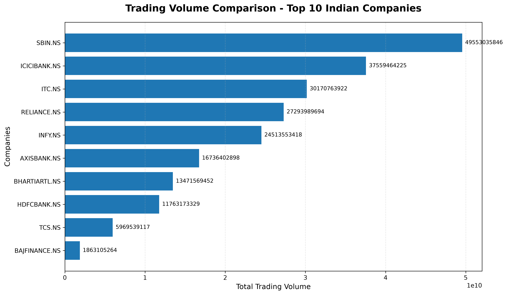
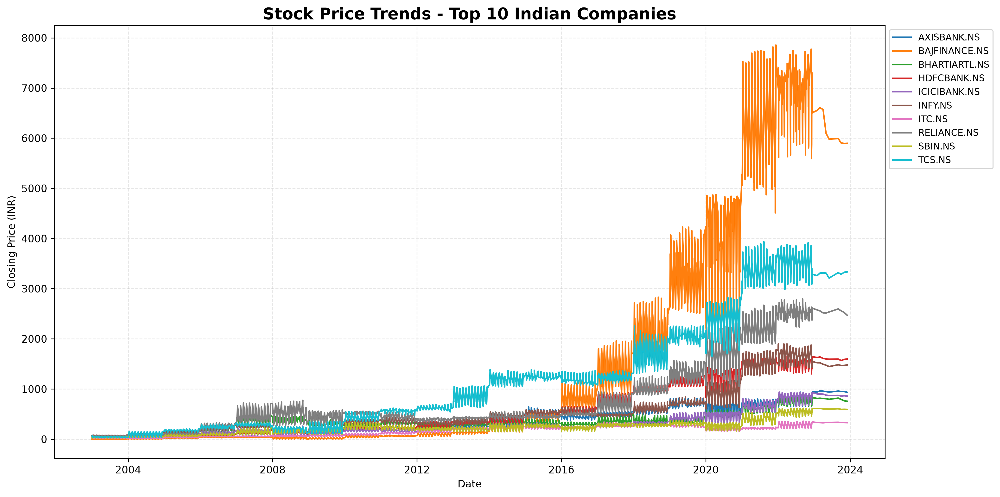
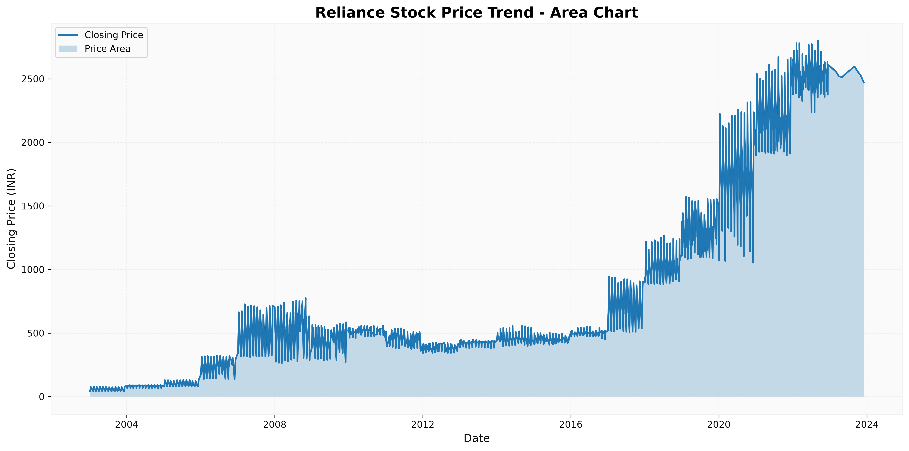
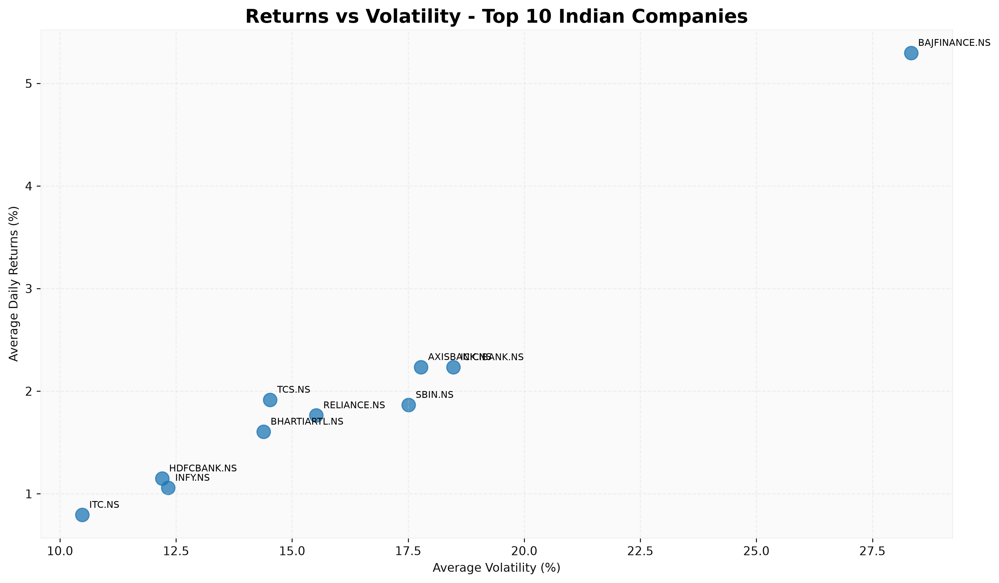

# 📈 Stock Market Performance Analytics

## 📌 Project Overview
This project performs Exploratory Data Analysis (EDA) on historical stock market data of 10 major Indian companies using Python. It analyzes stock price movements, daily returns, trading volume, moving averages, and volatility to understand historical market performance and trends.

## 🎯 Project Objectives
- Analyze historical stock price trends.
- Calculate daily returns and stock volatility.
- Compare the performance of 10 major Indian companies.
- Analyze trading volume and moving averages.
- Visualize market trends using Python charts.

## 🏢 Companies Analyzed
RELIANCE, TCS, INFY, HDFCBANK, ICICIBANK, AXISBANK, SBIN, BAJFINANCE, ITC, BHARTIARTL.

## 🛠️ Technologies Used
- Python
- Pandas
- NumPy
- Matplotlib
- Seaborn
- Jupyter Notebook

## 📊 Key Analysis
1. Historical Stock Price Analysis
2. Daily Returns Analysis
3. 20-Day and 50-Day Moving Averages
4. Stock Volatility Analysis
5. Trading Volume Comparison
6. Returns vs Volatility Analysis

## 📉 Project Visualizations

### 1. Trading Volume Comparison


### 2. Stock Price Trends – Line Chart


### 3. Stock Price Trends – Area Chart


### 4. Average Returns vs Volatility


## 📁 Project Structure
```text
Stock-Market-Performance-Analytics/
│
├── charts/
├── dataset/
├── stock_analysis.ipynb
├── stock_market_summary.csv
├── README.md
```

## 🚀 How to Run the Project

1. Clone this repository:
   `git clone https://github.com/asma-afzal-sayyed/Stock-Market-Performance-Analytics.git`

2. Install required libraries:
   `pip install pandas numpy matplotlib seaborn jupyter`

3. Open Jupyter Notebook:
   `jupyter notebook`

4. Open `stock_analysis.ipynb` and run the cells.

## 📂 Dataset Source
Historical stock market dataset: [Zenodo Dataset](https://zenodo.org/records/7819848)

## 👩‍💻 Author
**Asma Afzal Sayyed**

[GitHub](https://github.com/asma-afzal-sayyed) | [LinkedIn](https://www.linkedin.com/in/asma-sayyed-9501b8365) | [Portfolio](https://asma-afzal-sayyed.github.io/Professional-Portfolio/)

---
*This project is for educational and analytical purposes only. It does not provide financial or investment advice.*
